  

  
  
  

## Hey there, it's Nook!

I'm a full-stack developer from Thailand who likes owning a feature from the database schema to the deploy pipeline. I build with the MERN stack and TypeScript, ship in Docker, and I'm growing toward cloud and DevOps work.

**Open to junior full-stack roles.**

## Featured work

| Project | What it is | Built with |
| --- | --- | --- |
| **[Portask](https://github.com/nookarin/Portask)** | B2B client portal for creative agencies. Staff run projects, tasks and milestones; clients follow progress, comment and approve deliverables. Five roles, public progress reports by link, CI/CD. | React, Vite, Tailwind, Express, TypeScript, Prisma, PostgreSQL, Docker, nginx, GitHub Actions |
| **[WSL Desk Manager](https://github.com/nookarin/WSL-Desk-Manager-Downloads)** | Windows app that brings up a full desktop environment for your WSL distros in as few clicks as possible. | Windows desktop |
| **[Desuko](https://github.com/nookarin/desuko-releases)** | Desktop app with installers and an auto-update feed. | JavaScript |

## Toolbox

**Frontend**&nbsp;

**Backend**&nbsp;

**Ship it**&nbsp;

